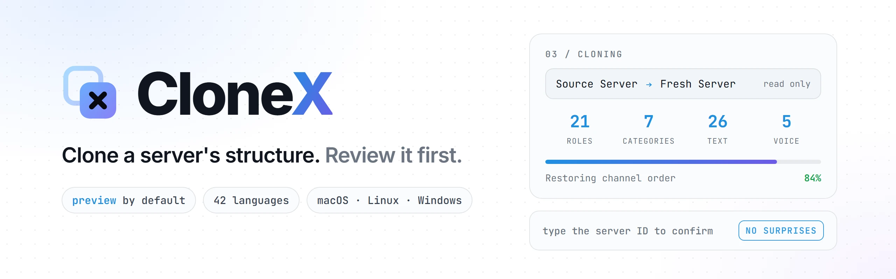
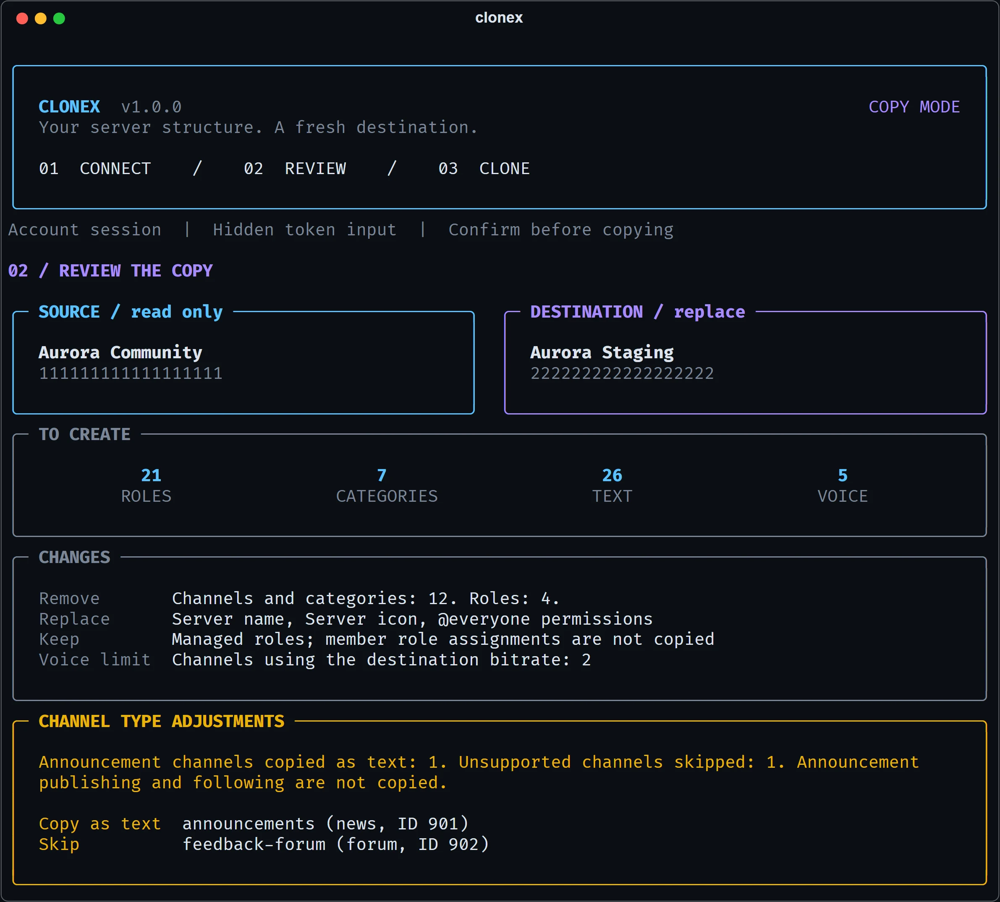
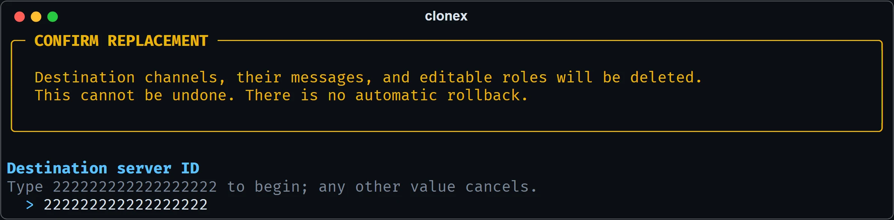
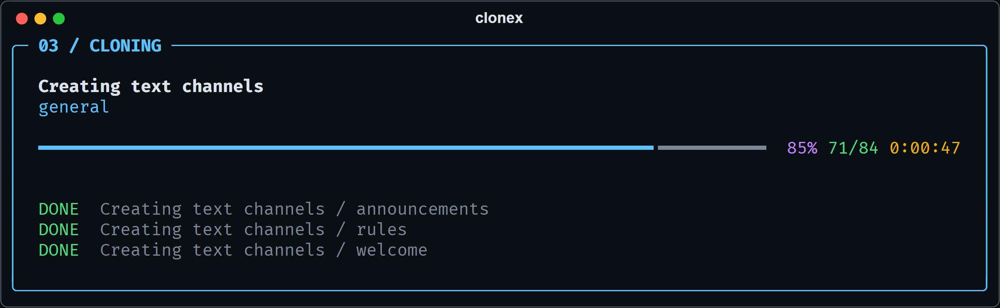
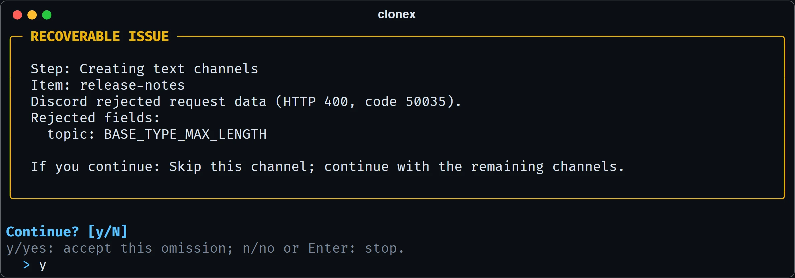
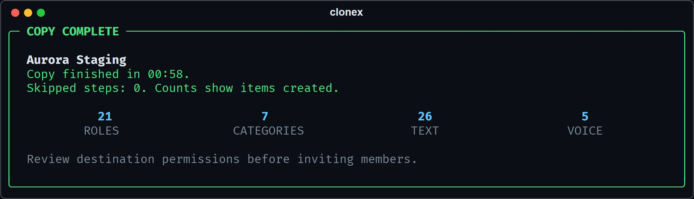
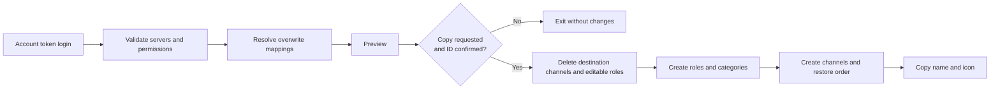
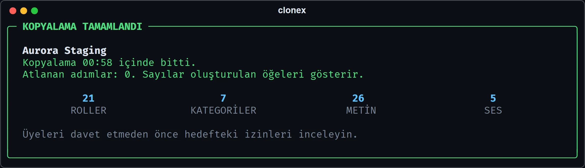
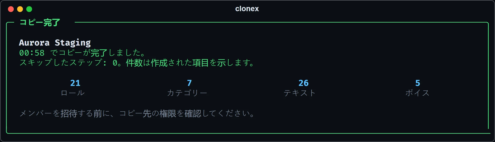

<div align="center">

<picture>
  <source media="(prefers-color-scheme: dark)" srcset="docs/assets/banner-dark.webp">
  
</picture>

<br>

**Copy the roles, categories and channels of a Discord server into another one, with a full preview and an explicit confirmation before anything changes.**

<br>

[](https://www.python.org)
[](https://pypi.org/project/discord.py-self/)
[](https://github.com/Textualize/rich)
[](https://docs.astral.sh/uv/)
[](https://docs.astral.sh/ruff/)
[](https://mypy-lang.org)
<br>
[](#install)
[](https://github.com/kaanxsrd/homebrew-tap)
[](https://github.com/kaanxsrd/scoop-bucket)
[](docs/languages.md)
[](LICENSE)

**[Install](#install)** ·
**[Quick start](#quick-start)** ·
**[What gets copied](docs/copying.md)** ·
**[Configuration](docs/configuration.md)** ·
**[Languages](docs/languages.md)** ·
**[Changelog](CHANGELOG.md)** ·
**[Security](SECURITY.md)**

</div>

<br>



<table>
  <tr>
    <td width="50%"></td>
    <td width="50%"></td>
  </tr>
  <tr>
    <td align="center"><sub>Nothing changes until you type the server ID.</sub></td>
    <td align="center"><sub>Every step, live.</sub></td>
  </tr>
  <tr>
    <td width="50%"></td>
    <td width="50%"></td>
  </tr>
  <tr>
    <td align="center"><sub>A rejected item is your decision, not a crash.</sub></td>
    <td align="center"><sub>A report of what was really created.</sub></td>
  </tr>
</table>

> [!WARNING]
> A default copy **deletes all existing destination channels and their message history, and replaces editable roles**. There is no undo. Use a fresh, disposable destination server first, or [turn replacement off](docs/configuration.md#replace).

> [!CAUTION]
> CloneX automates a personal Discord account, which [Discord's Terms of Service](https://discord.com/terms) do not allow. Discord can suspend accounts for doing this, and you accept that risk by using it.

## Features

<table>
  <tr>
    <td width="50%" valign="top">

**Preview by default**<br>
Checks both servers and shows the full plan without changing anything. Copying is a separate, deliberate choice.

</td>
    <td width="50%" valign="top">

**Explicit confirmation**<br>
Before a copy starts you type the destination server ID. Any other answer cancels, so the wrong window can't cost you a server.

</td>
  </tr>
  <tr>
    <td valign="top">

**Recover, don't restart**<br>
When Discord rejects one item, CloneX says what happened and exactly what continuing means, then waits for your answer. Login and access failures always stop.

</td>
    <td valign="top">

**Accurate permissions**<br>
Roles and categories map by ID, so duplicate names can't collide. A permission rule is never dropped silently, because that can make a private channel visible.

</td>
  </tr>
  <tr>
    <td valign="top">

**Copy exactly what you want**<br>
A [settings file](docs/configuration.md) chooses roles, categories, text and voice channels, permissions, name and icon, and whether to replace or only add.

</td>
    <td valign="top">

**Fast where it counts**<br>
Channel order takes a few bulk requests rather than one or two per channel, which removes the slowest part of a copy.

</td>
  </tr>
  <tr>
    <td valign="top">

**[42 languages](docs/languages.md)**<br>
Follows your system language automatically. Add or correct a language by dropping one JSON file in your settings folder, with no rebuild.

</td>
    <td valign="top">

**Every platform**<br>
A single program for macOS, Linux and Windows on x64 and arm64, with no Python needed. Your token stays in memory and is never written to disk.

</td>
  </tr>
</table>

## Quick start

```sh
uv tool install git+https://github.com/kaanxsrd/CloneX
clonex --demo     # see the interface, no login needed
clonex            # choose Preview or Copy
```

You need your own account in both servers, Administrator in the destination, and Developer Mode on so you can **Copy Server ID**. Your token is read through hidden input, or from `DISCORD_USER_TOKEN`. The [copying guide](docs/copying.md#before-you-start) has the details.

Or go straight to it from a script:

```sh
clonex --source 111111111111111111 --target 222222222222222222          # preview
clonex --source 111111111111111111 --target 222222222222222222 --apply  # copy, after confirming
```

## Install

| Platform                         | Command                                                                                          |
| -------------------------------- | ------------------------------------------------------------------------------------------------ |
| **Any** (Python 3.11+)           | `uv tool install git+https://github.com/kaanxsrd/CloneX`                                         |
| **macOS and Linux** (Homebrew)   | `brew install --cask kaanxsrd/tap/clonex`                                                        |
| **Windows** (Scoop)              | `scoop bucket add clonex https://github.com/kaanxsrd/scoop-bucket` then `scoop install clonex`   |

[Release archives](https://github.com/kaanxsrd/CloneX/releases/latest) for macOS, Linux and Windows (x64 and arm64) come with checksums and need nothing else installed.

<details>
<summary><b>Running a downloaded archive</b></summary>

<br>

```sh
tar -xzf clonex_*_linux_amd64.tar.gz    # macOS: clonex_*_darwin_arm64.tar.gz
./clonex
```

On Windows, extract the `.zip` and double-click `clonex.exe`.

Releases are not code-signed. On macOS, clear the quarantine flag with `xattr -d com.apple.quarantine ./clonex`. Windows may show **Windows protected your PC**, where **More info** then **Run anyway** continues. CloneX receives your account token, so only run a copy you trust, and compare it with `checksums.txt` from the same release.

</details>

## How it works



<details>
<summary><b>What gets copied</b></summary>

<br>

| Item                  | Behavior                                                                                         |
| --------------------- | ------------------------------------------------------------------------------------------------ |
| Server identity       | Name and icon, using a static PNG if animated icons are unavailable                              |
| Roles                 | Names, permissions, colors, hoist, mentionability and order                                      |
| Categories            | Names, order and permission overwrites                                                           |
| Text channels         | Names, categories, order, topics, NSFW flags, slowmode and thread defaults                       |
| Announcement channels | Recreated as standard text channels                                                              |
| Voice channels        | Names, categories, order, NSFW flags, slowmode, user limits, region, video quality and bitrate   |
| Forum and stage       | Skipped, and listed in the preview                                                               |

Messages, members, member role assignments, emojis, stickers, webhooks and invites are **not copied**. This is a structure copier, not a backup or a sync service. The [copying guide](docs/copying.md) covers every edge case.

</details>

## Configuration

Run `clonex --init-config` to create a commented settings file, or put a `clonex.toml` in the current folder.

```toml
language = "tr"            # or "auto" to follow your system

[copy]
voice_channels = false     # leave voice channels out
server_icon = false        # keep the destination's icon

[replace]
channels = false           # add alongside existing channels instead of deleting them
roles = false
```

Any setting also works for a single run: `clonex --set copy.roles=false`. Tokens can never be stored in a settings file. The [configuration guide](docs/configuration.md) lists every option.

## Languages

CloneX follows your system language and ships 42 of them, including every language Discord's own client offers. Use `--lang` or `language` to pick one, and `clonex --list-languages` to see them all.

<table>
  <tr>
    <td width="50%"></td>
    <td width="50%"></td>
  </tr>
  <tr>
    <td align="center"><sub><code>--lang tr</code></sub></td>
    <td align="center"><sub><code>--lang ja</code></sub></td>
  </tr>
</table>

## Develop

Requires [uv](https://docs.astral.sh/uv/), on macOS, Linux or Windows. Nothing else is needed: uv installs Python and the locked dependencies.

```sh
git clone https://github.com/kaanxsrd/CloneX && cd CloneX
uv sync
uv run clonex --demo
uv run python scripts/check.py
```

The tests run the real discord.py-self models against an in-memory HTTP layer, so they need no token and make no Discord calls.

<details>
<summary><b>Scripts</b></summary>

<br>

| Command                                          | What it does                                                 |
| ------------------------------------------------ | ------------------------------------------------------------ |
| `uv run python scripts/check.py`                 | Ruff, formatting, mypy and the tests                         |
| `uv run pytest`                                  | The tests                                                    |
| `uv run --group build python scripts/build.py`   | Builds and smoke-tests the executable for this platform      |
| `python scripts/release.py patch\|minor\|major`  | Bumps the version, dates the changelog, commits and tags     |

</details>

<details>
<summary><b>Repository layout</b></summary>

<br>

```text
clonex/
  cli.py              Arguments, menu and token input
  config.py           Settings: defaults, the file, overrides and validation
  i18n.py             Translations and language detection
  session.py          The Discord connection and the preview/copy flow
  core/
    plan.py           Read-only validation and copy planning
    executor.py       Sequential changes to the destination
    recovery.py       Recovery decisions and critical-error classification
    discord_errors.py Safe formatting of Discord errors
    models.py         Shared data, free of Discord imports
  ui/                 Terminal panels, live progress and the offline demo
  locales/            One JSON file per language
tests/                Offline test suite
packaging/            PyInstaller recipe and icon
scripts/              Checks, builds, releases and package manager manifests
docs/                 Guides and README images
```

</details>

## Documentation

| Guide                                      | What's inside                                                      |
| ------------------------------------------ | ------------------------------------------------------------------ |
| [Copying](docs/copying.md)                 | Requirements, what is copied, recovery, exit codes and your token  |
| [Configuration](docs/configuration.md)     | Every setting and where settings files live                        |
| [Languages](docs/languages.md)             | The 42 languages, detection and how to add one                     |
| [Troubleshooting](docs/troubleshooting.md) | Discord errors and what to do about them                           |
| [Changelog](CHANGELOG.md)                  | What changed in each version                                       |
| [Contributing](CONTRIBUTING.md)            | Setup, conventions, translations and releases                      |
| [Security policy](SECURITY.md)             | How to report a vulnerability                                      |

## Credits

CloneX is an updated and modified version of [Server Mirror](https://github.com/ArviiSoft/server-mirror) by [ArviiSoft](https://github.com/ArviiSoft), whose original code is available under the MIT License. [NOTICE](NOTICE.md) has the original license and a summary of what changed.

## License

[GNU General Public License v3.0](LICENSE) © Vante. CloneX is free software: you can redistribute and modify it under the terms of the GPL, version 3. It comes with no warranty.

<div align="center">
<br>
<sub>Built for everyone who has ever rebuilt a server by hand.</sub>
</div>
